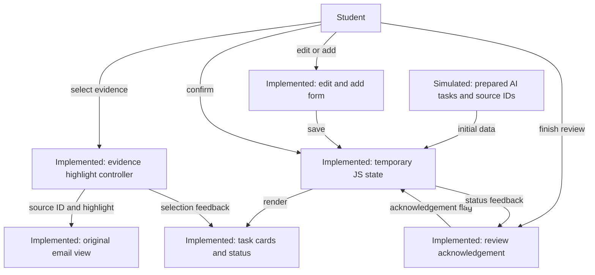
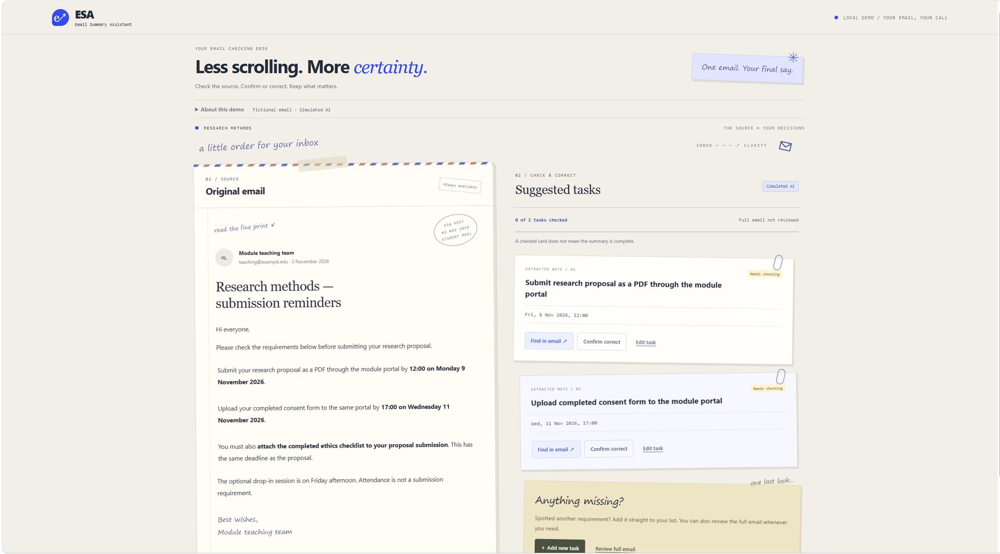
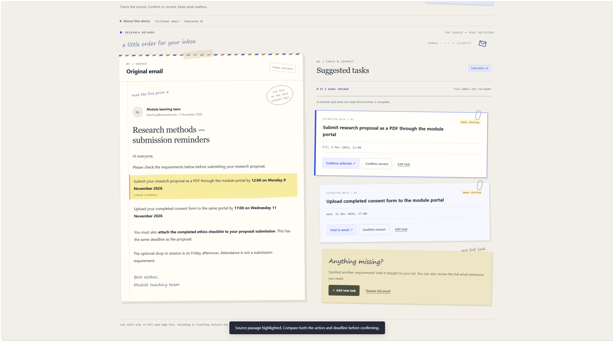
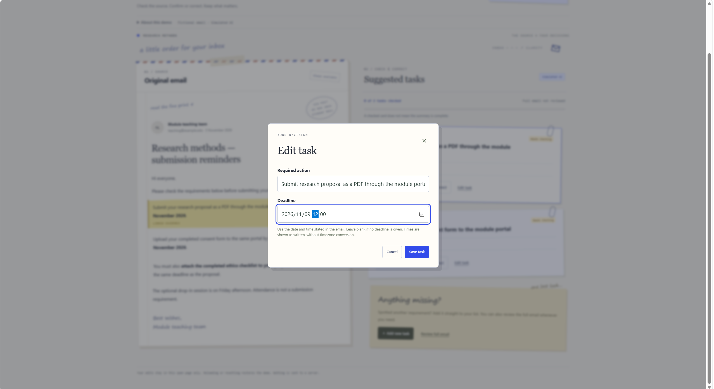
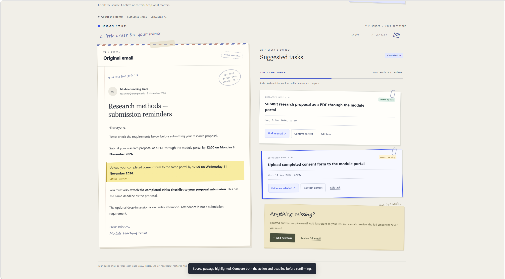
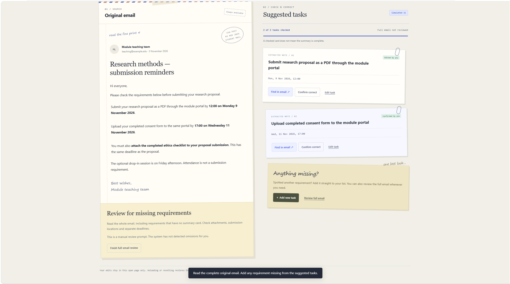
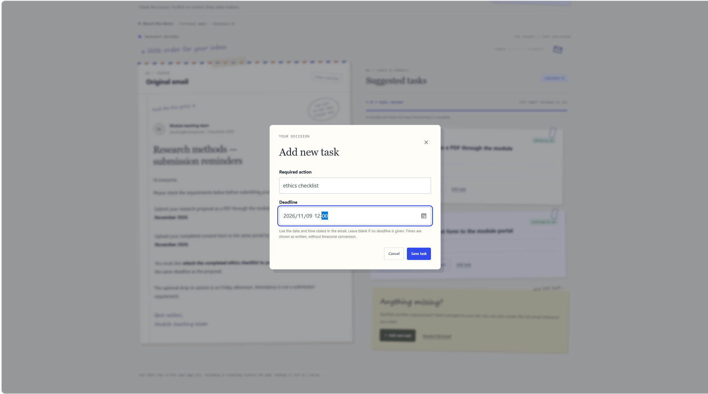
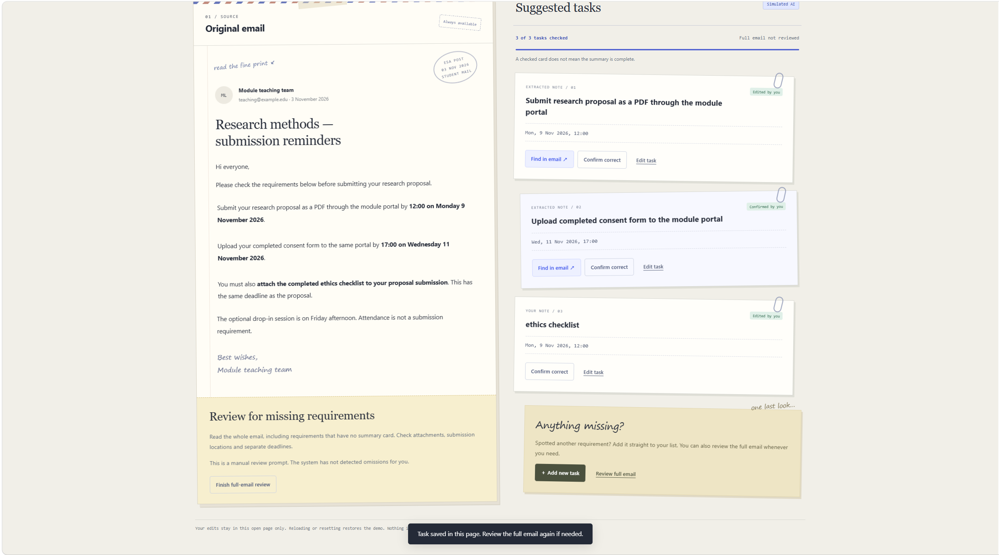
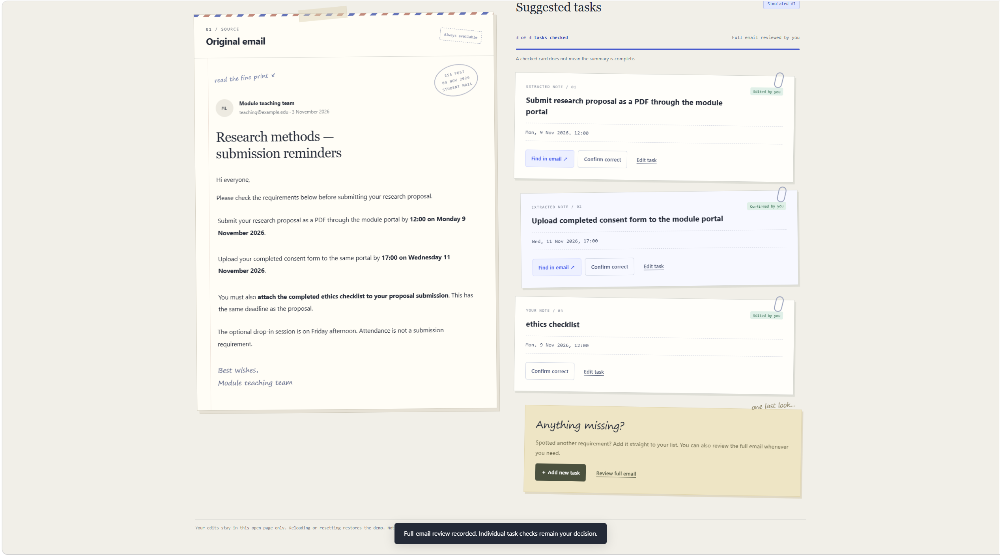

# ESA Email Summary Assistant

Xuran Ding

Total report word count: 1,188 (abstract 187; main report 1,001, including section headings). Whitespace-based count; figures, references and submission links excluded.

Repository: https://github.com/dawsen1208/esa-email-summary-assistant

README: https://github.com/dawsen1208/esa-email-summary-assistant/blob/main/README.md

Development record: https://github.com/dawsen1208/esa-email-summary-assistant/blob/main/development-feedback.md

Current prototype draft snapshot: https://github.com/dawsen1208/esa-email-summary-assistant/commit/db98b8ee3a69b31ad9111f97e773b48f627aabca

Final submitted commit or release: pending completion of screenshots and final checks.

## Abstract

University emails can contain several deadlines and required actions. Students using AI summaries need ways to inspect these details before acting, particularly when a summary contains an incorrect date or omits a requirement. ESA, Email Summary Assistant, is a local interactive prototype that supports checking through links between suggested tasks and highlighted email passages.

Built with HTML, CSS and JavaScript, ESA presents one fictional English university email alongside prepared task cards. Users can inspect supporting passages, confirm or edit tasks, add missing requirements and acknowledge a full-email review. Interface behaviour is implemented; AI extraction and evidence selection are simulated using fixed data. The demonstration includes an incorrect deadline and an omitted ethics checklist.

The design applies course concepts concerning provenance, recognition rather than recall, feedback and user control. Development included my self-review and decisions to simplify task addition, remove duplicate controls and reduce the introductory area's size. Full-email review remains user-led: completion does not trigger omission detection or certify completeness. Current checks cover selected state transitions, not usability outcomes. The prototype demonstrates a verification interaction, while its effects on accuracy, checking time and missed requirements remain unevaluated.

## Problem and project scope

My A1 review asked whether linking summary claims to source passages could help students check university emails. Maynez et al. (2020) demonstrate unsupported content in generated summaries; Zhang et al. (2022) investigate faithful email task generation. Neither establishes how students will detect remaining errors. ESA develops the verification interaction rather than testing a new generation model. Its scope is one fictional email containing explicit deadlines and required actions. There is no live mailbox, model call or automatic omission detector. This makes the interaction inspectable while limiting what can be claimed about intelligence and effectiveness.

## Design rationale

### Making evidence inspectable

Each prepared task has a Find in email control that highlights its source paragraph. Kryscinski et al. (2020) provide evidence that extracted spans can assist consistency checking, although their news-summary setting differs from this project. Lecture 11 distinguishes displaying a source from merely citing it and stresses specific, accessible provenance (University of Birmingham, n.d., L11, pp. 8–10). ESA applies this principle through visible passages. A link enables comparison; it does not prove correctness. The full email remains available because links cannot reveal requirements absent from the summary.

### Supporting comparison and correction

Task cards separate actions and deadlines, reflecting the action-oriented email summaries discussed by Zhang et al. (2022). On desktop, source and summary appear side by side; on narrow screens they stack. Visible controls support recognition rather than recalling commands, while keeping information on screen is intended to reduce avoidable memory demands (L05, pp. 8–10). I chose cards and forms because checking dates requires precise entry and comparison, tasks Lecture 07 identifies as poorly served by conversation alone (pp. 16–17). Reduced cognitive load is a design intention, not a measured result.

Users can confirm a task or edit its wording and deadline. Amershi et al. (2019) support efficient correction when AI is wrong. Lecture 06 connects signifiers with the gulf of execution and visible feedback with the gulf of evaluation (pp. 4–6). Edit task identifies the available action; Save and Cancel provide explicit choices. Updated content and Edited by you show the consequence and its author. Confirmation similarly means Confirmed by you, not machine-verified correctness. Changes last only within the open page, trading persistence for a simpler local demonstration.

### Feedback and completeness

Selecting evidence marks the card with a blue edge and selection text while highlighting the original passage in yellow. This combines local textual and visual feedback rather than relying solely on a temporary notification. Lecture 04 explains why peripheral cues may be missed and why feedback should fit the current task (pp. 5–6, 18–19). These cues are intended to make the connection noticeable; their accessibility and effectiveness still require browser checks and user evaluation.

I kept omission review separate from individual task checks. Anything missing? provides direct manual addition and an optional full-email review prompt. Finish full-email review records acknowledgement, displays feedback and closes the guidance card. I considered predefined hints about missed requirements but rejected them to retain the verification scope. Such hints would introduce answer checking and require another explanation of system capability. This follows Lecture 03's emphasis on communicating capability boundaries (pp. 7–8, 12). Users may still finish without noticing an omission; checked progress is not a completeness guarantee.

This scope also involves a control trade-off. Students can confirm a card without first opening its evidence, because the interface does not enforce a fixed sequence. That supports flexible checking but permits superficial confirmation. Likewise, manually added tasks count towards checked progress because they originate with the student, not because ESA has validated them. These behaviours need to be explained and evaluated rather than presented as proof of appropriate reliance. The deliberately incorrect deadline and omitted checklist create reproducible demonstration cases; they are not evidence of how frequently such errors occur in real university emails.

## System and illustrated interaction

Figure 1 separates implemented interface components from simulated intelligence. Prepared task objects supply action text, deadlines and source identifiers to JavaScript state. Rendering creates cards; evidence selection uses an identifier to highlight an HTML paragraph. Save, confirmation and review actions update state and feedback. CSS supplies the responsive letter-inspired presentation. The intended intelligent component would infer tasks and evidence from email content, but fixed fixtures substitute for it here, consistent with Lecture 02's instruction to distinguish existing and stubbed layers (p. 22). User edits do not train a model.

Figures 2–4 specify three walkthroughs. First, the proposal card incorrectly states 6 November 2026; its source states 9 November at 12:00. The student inspects the passage and corrects the date. Second, they compare and confirm the correct consent-form requirement. Third, they read the full email, notice the omitted ethics checklist, add it manually and acknowledge review. New tasks have no generated evidence link. Saving an addition or edit resets full-email review, making a previous acknowledgement distinct from the changed list.

## Development decisions and checks

During my own trial, I found the freedom limited, the flow unclear and the content thin. I identified unnecessary navigation: adding a task required opening review guidance first. I requested direct addition from Anything missing?, then removal of the duplicate add button. I also requested that completion close the review card. These decisions simplify the route without implying automatic checking. My preference for correspondence imagery led to handwritten accents and paper details; I subsequently reduced the oversized introduction to prioritise the working area. These changes address specific observations, not all remaining usability concerns.

Codex generated the initial code and assisted subsequent revisions and documentation; I supplied the project direction, reviewed the prototype and requested these changes. Script-based checks using a simplified DOM passed for direct addition, cancellation, saving, review reset, closing and reopening guidance, and unchanged acknowledgement feedback. They do not establish browser layout or accessibility. Remaining limitations include one fixed example, temporary storage and source links that are not revalidated after edits. Future evaluation should separately measure incorrect-claim correction and omission detection, comparing source-linked checking with access to the full email alone. No improvement in accuracy or speed is currently claimed.

## Figures

### Figure 1 System architecture

Prepared data replaces model inference. All changes remain in the browser page.

### Figure 2 Correcting a deadline

**2a Suggested deadline before checking**

**2b Source evidence selected**

**2c Student edits the deadline**

**2d Correction saved**

Source checked; deadline corrected by the student.

### Figure 3 Confirming a task

**3a Compare the task with its source**

**3b Student confirms the task**

Confirmation records the student's judgement.

### Figure 4 Adding an omitted requirement

**4a Review the complete email**

**4b Enter the missing requirement**

**4c Manually added task after editing**

**4d Full-email review acknowledged**

Panels 4c and 4d show different checklist states: Edited by you and Added by you. They are not an uninterrupted transition.

The student finds the omission; ESA records the addition and acknowledgement.

## References

Amershi, S., et al. (2019). Guidelines for Human-AI Interaction. *Proceedings of the 2019 CHI Conference on Human Factors in Computing Systems*, Article 3, 1–13. doi:10.1145/3290605.3300233.

Kryscinski, W., McCann, B., Xiong, C. and Socher, R. (2020). Evaluating the Factual Consistency of Abstractive Text Summarization. *Proceedings of EMNLP 2020*, 9332–9346. doi:10.18653/v1/2020.emnlp-main.750.

Maynez, J., Narayan, S., Bohnet, B. and McDonald, R. (2020). On Faithfulness and Factuality in Abstractive Summarization. *Proceedings of ACL 2020*, 1906–1919. doi:10.18653/v1/2020.acl-main.173.

Zhang, K., Chen, J. and Yang, D. (2022). Focus on the Action: Learning to Highlight and Summarize Jointly for Email To-Do Items Summarization. *Findings of ACL 2022*, 4095–4106. doi:10.18653/v1/2022.findings-acl.323.

University of Birmingham (n.d.). *Intelligent Interactive Systems*. Course lecture slides supplied for this project. Lecture identifiers in the text refer to:

- L02: Ingredients of an Intelligent Interactive System.
- L03: Human-Centred Intelligent Interaction and the Shape of the Module.
- L04: Perception, Attention and Feedback.
- L05: Memory, Mental Models and Cognitive Load.
- L06: Action, Error, Agency and Decision.
- L07: Conversational Interfaces.
- L11: Retrieval, Grounding and Provenance.
