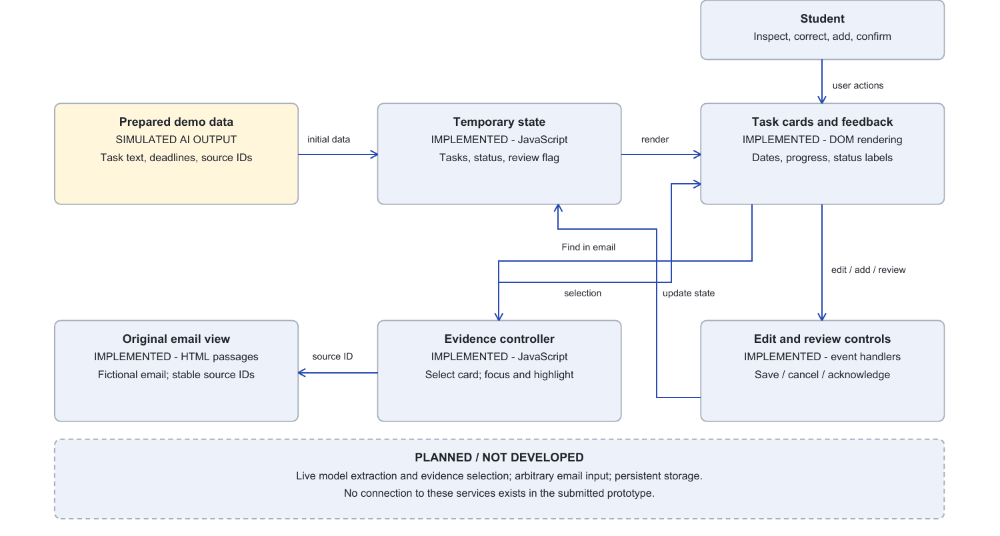
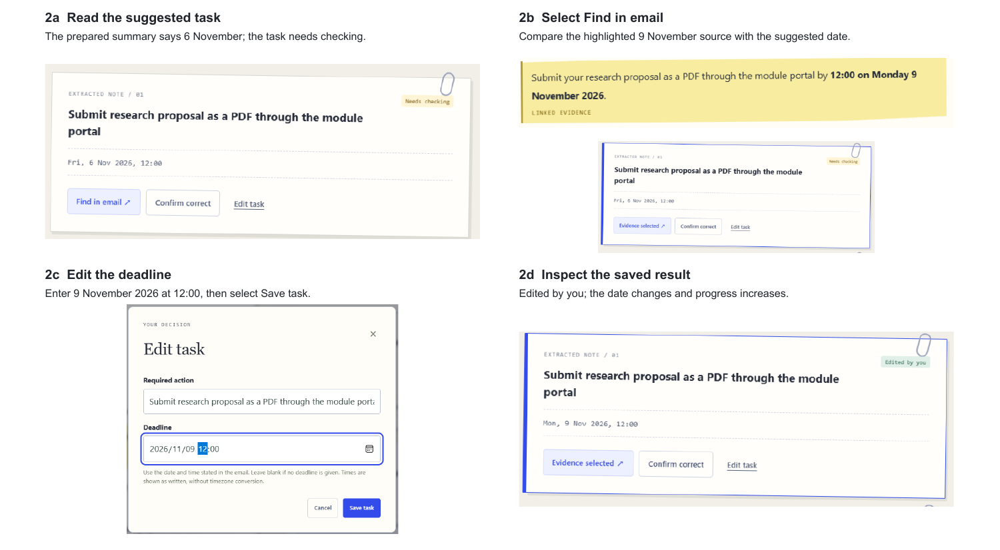
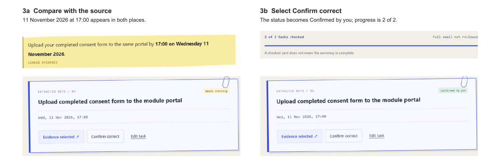
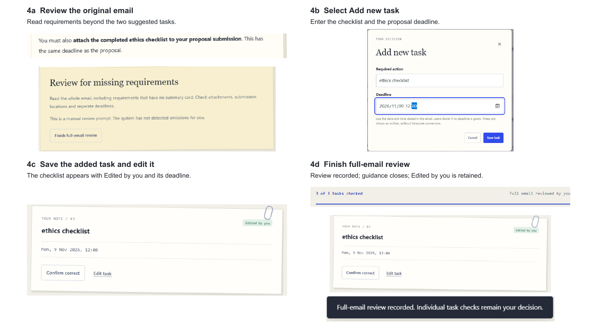

# ESA Email Summary Assistant

A Prototype for Checking University Email Summaries

| Field | Details |
| --- | --- |
| Module | Intelligent Interactive Systems |
| Assessment | Assignment 2 Project Report |
| Author | Xuran Ding |
| Date | 15 November 2026 |
| Total words | 1,219 (abstract 171; main report 1,048) |

Total report word count: 1,219 (abstract 171; main report 1,048, including section headings but excluding heading numbers). Figures, references and repository links excluded.

## Repository and submitted version

Repository: https://github.com/dawsen1208/esa-email-summary-assistant

README: https://github.com/dawsen1208/esa-email-summary-assistant/blob/main/README.md

Development record: https://github.com/dawsen1208/esa-email-summary-assistant/blob/main/development-feedback.md

Submitted prototype and screenshot snapshot: https://github.com/dawsen1208/esa-email-summary-assistant/commit/3a4497c

Submitted repository documentation snapshot: https://github.com/dawsen1208/esa-email-summary-assistant/commit/7d7a43e696dbfbc765add17c95872dc3d87ca18c

## Abstract

University emails often include several tasks and deadlines. AI summaries can help students find this information, but they can also give a wrong date or miss a requirement. ESA, Email Summary Assistant, is a local prototype that helps students check suggested tasks against the original email.

The prototype uses HTML, CSS and JavaScript. It shows one fictional university email and prepared task cards. Students can find the source text, confirm a task, change its details and add a missing task. These controls work, but the AI output and source links use fixed data. The example includes a wrong deadline and a missing ethics checklist.

The design uses course ideas about source evidence, memory, feedback and user control. I reviewed the prototype and asked for a simpler way to add tasks, fewer repeated buttons and a smaller introduction. Finishing the full-email review only records the student's choice. It does not check for missing information. The current checks cover selected actions, and there is no user study showing better accuracy or faster checking.

## Problem and project scope

My A1 review asked whether links from a summary to its source could help students check university emails. Maynez et al. (2020) show that generated summaries can include information that the source does not support. Zhang et al. (2022) study how to generate email tasks that match the source. These studies do not show how students will find all the errors that remain. ESA focuses on how students check a summary. It uses one fictional email with clear tasks and deadlines. It has no live mailbox, AI model call or automatic check for missing requirements. This keeps the example simple, but it limits what the prototype can show.

## Design rationale

### Making evidence easy to check

Each prepared task has a Find in email button. It highlights the related paragraph in the original email. Kryscinski et al. (2020) show that text taken from the source can help people check whether a summary matches it. Their study uses news summaries, so its results may not apply directly to student emails. Lecture 11 explains why source evidence should be clear and easy to access (University of Birmingham, n.d., L11, pp. 8–10). ESA shows the source text so students can compare it with a task. A source link does not prove that the task is correct. Students can still read the full email to look for requirements that have no task card.

### Helping students compare and correct tasks

The cards show actions and deadlines separately. This follows the focus on email tasks in Zhang et al. (2022). On a desktop, the email and cards appear side by side. On a narrow screen, they appear one below the other. Visible buttons help students recognise what they can do. Keeping both texts on screen may also reduce what they need to remember (L05, pp. 8–10). I chose cards and forms because students need to compare dates and enter exact details. Lecture 07 explains that conversation alone may not suit these tasks (pp. 16–17). I have not measured whether this design reduces mental effort.

Students can confirm a task or edit its action and deadline. Amershi et al. (2019) explain that users should be able to correct AI errors easily. Lecture 06 discusses clear controls and feedback through the gulf of execution and the gulf of evaluation (pp. 4–6). Edit task shows how to make a change. Save and Cancel give clear choices. Edited by you shows who changed the task. Confirmed by you records the student's decision, not an automatic accuracy check. Changes are lost when the page is reloaded or reset. This avoids adding storage to the local prototype.

### Feedback and missing requirements

When students select evidence, the card gets a blue border and a text label. The source paragraph turns yellow. This gives feedback in both places. Lecture 04 explains that users may miss feedback away from the task they are doing (pp. 5–6, 18–19). These changes aim to make the link easier to notice, but browser checks and user testing are still needed.

Anything missing? lets students add a task directly or open the full-email review guide. Finish full-email review records their decision, shows a message and closes the guide. I decided against hints that name a missing requirement. These hints would add answer checking and would need a clear explanation of how the system works. Lecture 03 stresses the need to explain system limits (pp. 7–8, 12). Students can finish the review and still miss something.

Students can also confirm a card before opening its evidence. This gives them more choice, but they may confirm without checking carefully. Added tasks count towards progress because students entered them, not because ESA checked them. The wrong date and missing checklist are prepared examples. They do not show how often these errors happen in real emails.

## System and illustrated interaction

Figure 1 in Appendix A shows the working parts and the simulated AI output. Prepared data gives JavaScript the task text, deadlines and source IDs. JavaScript displays the cards and uses each source ID to highlight an email paragraph. Saving, confirming and reviewing update the page state and feedback. CSS controls the layout and letter style. A future AI component could find tasks and source text in new emails. This version uses fixed data instead. Lecture 02 asks students to explain which parts work and which are simulated (p. 22). User edits do not train a model.

Figures 2–4 in Appendix A show three examples. In Figure 2, the proposal card gives 6 November 2026, but the email says 9 November at 12:00. The student checks the source and changes the date. In Figure 3, the student checks and confirms the correct consent-form task. In Figure 4, the student reads the full email, finds the missing ethics checklist, adds and edits the task, then finishes the review. Added tasks have no automatic source link. Saving an addition or edit resets the full-email review status because the task list has changed.

## Development decisions and checks

In my own trial, I found that the prototype gave limited choice, the steps were unclear and the content was thin. Adding a task first required opening the review guide. I asked for a direct Add new task button in Anything missing? and removed the repeated add button. I also asked for the guide to close after review. I chose handwritten text and paper details to give the page a letter style. I then made the introduction smaller to leave more room for checking emails. These changes address my feedback, but they do not solve all possible usability problems.

Codex generated the first code and helped with changes, checks and report writing. I provided the idea, reviewed the prototype and chose these changes. Checks using a simplified DOM passed for adding, cancelling, saving, resetting review and closing the guide. These checks do not replace browser testing. My screenshots show the three example interactions. I replaced screenshots with different task states so the steps matched. There is no user study or full accessibility check.

The prototype still has one fixed email, temporary storage and source links that are not checked again after edits. Future testing should compare checking with source links and checking with only the full email, and measure date corrections and missed requirements separately.

## Figures

### Appendix A Figures

#### A.1  System architecture

Figure 1  Implemented, simulated and planned components.

#### A.2  Correcting an inaccurate deadline

Figure 2  Source checked and deadline corrected by the student.

#### A.3  Confirming an accurate task

Figure 3  Confirmation records the student's decision.

#### A.4  Adding a requirement found through manual review

Figure 4  The student finds the omission; ESA records the changes and acknowledgement.

## References

Amershi, S., Weld, D., Vorvoreanu, M., Fourney, A., Nushi, B., Collisson, P., Suh, J., Iqbal, S., Bennett, P.N., Inkpen, K., Teevan, J., Kikin-Gil, R. and Horvitz, E. (2019). Guidelines for Human-AI Interaction. Proceedings of CHI 2019, Article 3, pp. 1–13. doi:10.1145/3290605.3300233. Open-access version: https://www.microsoft.com/en-us/research/wp-content/uploads/2019/01/Guidelines-for-Human-AI-Interaction-camera-ready.pdf

Kryscinski, W., McCann, B., Xiong, C. and Socher, R. (2020). Evaluating the Factual Consistency of Abstractive Text Summarization. Proceedings of EMNLP 2020, pp. 9332–9346. doi:10.18653/v1/2020.emnlp-main.750. Open-access version: https://aclanthology.org/2020.emnlp-main.750/

Maynez, J., Narayan, S., Bohnet, B. and McDonald, R. (2020). On Faithfulness and Factuality in Abstractive Summarization. Proceedings of ACL 2020, pp. 1906–1919. doi:10.18653/v1/2020.acl-main.173. Open-access version: https://aclanthology.org/2020.acl-main.173/

Zhang, K., Chen, J. and Yang, D. (2022). Focus on the Action: Learning to Highlight and Summarize Jointly for Email To-Do Items Summarization. Findings of ACL 2022, pp. 4095–4106. doi:10.18653/v1/2022.findings-acl.323. Open-access version: https://aclanthology.org/2022.findings-acl.323/

University of Birmingham (n.d.). Intelligent Interactive Systems [lecture slides]. University of Birmingham. Accessed 6 November 2026.
